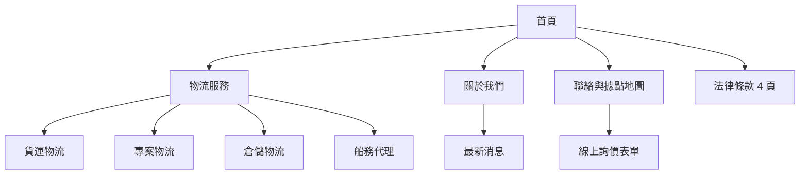

# Northgo 官網分析與重建方案

> 分析對象：<https://www.northgo.com/>（Webflow 建置，2024-11-11 品牌更名上線）
> 分析日期：2026-11-11

---

## 1. 摘要

Northgo（前身為 1988 年創立的 Max Seair Logistics）目前的官網視覺乾淨，但有三個結構性問題：

1. **多語系形同虛設**：`/zh-tw`、`/ja`、`/vi` 只翻譯了 H1，其餘內文都是英文。
2. **缺乏信任證據與轉換工具**：文案以抽象形容詞為主（effortless、seamless、simple），沒有數據、案例、認證，唯一的 CTA 是一般聯絡表單。
3. **SEO 基礎缺漏**：`sitemap.xml` 回傳 404、`/news` 回傳 404、標題字母被拆開、沒有結構化資料。

建議以 **Astro 靜態網站**完整重建，並同步重寫內容架構。

---

## 2. 現況診斷

### 2.1 內容與品牌

| 問題 | 位置 | 影響 |
| --- | --- | --- |
| 文案重複且抽象，"effortless / seamless / simple" 在首頁出現十次以上 | 首頁 | 無差異化，訪客記不住重點 |
| 沒有數據、客戶案例、合作航商、認證（AEO、IATA、FIATA、ISO） | 全站 | B2B 採購決策缺乏依據 |
| 「1988 年創立、30 年以上經驗」只放在 About 頁深處 | 關於 | 最強的信任資產沒被看見 |
| 服務摘要卡片的文字被截斷（"we offer secure..."），同段內容在同頁重複兩次 | 服務頁 | 看起來像未完成的頁面 |
| 沒有產業別頁面（電子、半導體設備、汽車零件、零售等） | 全站 | 失去長尾搜尋流量 |

### 2.2 多語系

- `/zh-tw` 首頁的 H1 是「讓物流變得 ‍輕鬆。」，但第一段以後全是英文。
- H1 中夾了零寬連接字元（U+200D），會影響搜尋、複製與螢幕閱讀器。
- 沒有 `hreflang` 對應，搜尋引擎可能把各語系視為重複內容。

### 2.3 SEO 與技術

| 項目 | 現況 |
| --- | --- |
| `sitemap.xml` | 404 |
| `/news` | 404（導覽中有連結） |
| 標題排版 | 「O f fice」、「e f fortless」以字母拆開排版，搜尋引擎與 Ctrl+F 讀不到正確字詞 |
| 結構化資料 | 沒有 Organization／LocalBusiness JSON-LD |
| 前端資源 | Webflow 的 jQuery 與 webflow.js、大張背景圖，拖慢行動裝置 LCP |

### 2.4 聯絡與轉換

- 7 個據點以純文字列出，電話與 Email 無法點擊撥打或寄信，也沒有地圖。
- 表單沒有運輸方式、起訖地、貨物類型等欄位，業務收到後還要再回頭詢問。
- 沒有報價、貨況追蹤、船期查詢的入口。

---

## 3. 問題優先序

| 優先 | 項目 | 投入 | 效益 |
| --- | --- | --- | --- |
| P0 | 修正 sitemap.xml、/news 404、字母拆開的標題 | 低 | 高 |
| P0 | 完整翻譯四語系並加上 `hreflang` | 中 | 高 |
| P1 | 結構化詢價表單、可點擊的電話與 Email、據點地圖 | 中 | 高 |
| P1 | 首頁加入數據列、品牌沿革、認證區塊 | 低 | 中 |
| P2 | LocalBusiness 結構化資料（七個據點） | 低 | 中 |
| P2 | 產業解決方案頁、新聞與案例內容經營 | 高 | 中 |

---

## 4. 技術選型比較

| 方案 | 優點 | 缺點 | 結論 |
| --- | --- | --- | --- |
| **Astro 靜態網站** | 預設不送 JS、內建 i18n 路由、Markdown/JSON 管理內容、可免費部署到 Netlify/Vercel/Cloudflare Pages | 需要工程人員更新內容（可日後再接 CMS） | **採用** |
| 純 HTML/CSS/JS | 零建置工具、門檻最低 | 4 語系乘以約 13 頁，要手動維護 50 個以上的檔案 | 不適合長期維護 |
| Next.js + Headless CMS | 最有彈性，非工程人員可編輯 | 對展示型企業官網太重，需要主機與 CMS 費用 | 未來若有會員或追蹤系統再考慮 |
| 續用 Webflow | 改動最少 | 多語系方案需額外付費，效能與 HTML 控制受限 | 僅適合短期修補 |

---

## 5. 新資訊架構

URL 規則：英文為預設語系（無前綴），其他語系使用 `/zh-tw`、`/ja`、`/vi` 前綴，與現有網址一致，避免舊連結失效。

---

## 6. 優化重點

- **轉換**：Header 固定放「取得報價」按鈕；詢價表單包含運輸方式、起運地、目的地、貨物類型、預計出貨日；電話使用 `tel:`、Email 使用 `mailto:`。
- **信任**：首頁數據列（1988 年創立、30 年以上經驗、7 個據點、3 個國家、全年無休支援）、品牌沿革時間軸、認證與合作夥伴區塊（預留位置，待實際素材）。
- **SEO**：每頁獨立 title 與 description、canonical、`hreflang`、Organization 與 LocalBusiness JSON-LD、自動產生 `sitemap.xml`。
- **效能**：不載入 jQuery、圖片用 SVG 或現代格式並延遲載入、系統字型堆疊，目標行動版 LCP 低於 2.5 秒。
- **無障礙**：語意化標題層級、跳至主要內容連結、鍵盤焦點樣式、色彩對比符合 WCAG AA。

---

## 7. KPI

| 指標 | 現況（估） | 上線 3 個月目標 |
| --- | --- | --- |
| Lighthouse 效能（行動版） | 約 60 到 75 | 95 以上 |
| Lighthouse SEO／無障礙 | 約 80 | 100／95 以上 |
| 已收錄頁數（Google Search Console） | 不完整（無 sitemap） | 4 語系全部收錄 |
| 詢價表單送出數 | 基準值 | 增加 30% |
| 非英語自然搜尋流量 | 極低 | 每月成長 |

---

## 8. 重建專案

原始碼位於 `northgo-site/`，說明請見 `northgo-site/README.md`。
